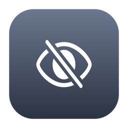
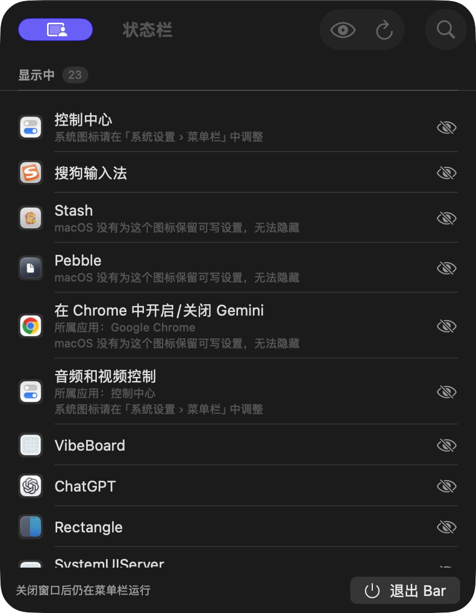

<p align="center"></p>
<h1 align="center">Bar · 状态栏</h1>
<p align="center">让菜单栏，留给常用的图标。</p>
<p align="center">macOS 26+ · 原生 SwiftUI · 本地运行 · GPL-3.0</p>

Bar 是一个轻量的 Mac 菜单栏图标管理器。打开一张列表，找到应用，隐藏偶尔才用的图标；需要时再显示回来。



> **1.0.0 正式版** · Apple Silicon / Intel 通用安装包，已使用 Developer ID 签名并通过 Apple 公证。运行验收与已知边界见 [VALIDATION](docs/VALIDATION.md)。

[下载与版本](https://github.com/perseveringman/easy-menubar/releases) · [反馈问题](https://github.com/perseveringman/easy-menubar/issues) · [隐私说明](docs/PRIVACY.md)

**当前源码为 1.1.0 开发版**：简化列表和权限说明，移除后台周期轮询，增加偏好缓存与受保护读取超时。实际验收见 [体验审计](docs/audit/EXPERIENCE.md)；已发布 1.0.0 的界面与说明见 [正式版文档](https://github.com/perseveringman/easy-menubar/blob/v1.0.0/README.md)。

## 一张列表，管理常用图标

- 搜索应用或图标名称，逐项隐藏与恢复。
- 使用显示开关管理图标，隐藏项目始终可恢复；未运行应用和只读图标默认折叠。
- 常驻搜索支持 `⌘F`，`Esc` 清除；`⌘R` 手动刷新，应用启动和退出时自动更新。
- 记住隐藏项目，即使应用退出也能在列表中恢复；“全部显示”批量恢复。
- 设置保存在 macOS 的应用偏好中，退出 Bar 后仍然保留。
- 原生 SwiftUI 界面，没有账户，不需要联网，也不需要屏幕录制权限。

## 使用

1. 将 `Bar.app` 放入 Applications 后打开。
2. 打开右侧开关显示图标，关闭开关隐藏图标。菜单栏工具可能会被正常重启，请先结束正在执行的任务；普通应用等待下次启动，或按提示手动重启。
3. 关闭窗口后 Bar 留在菜单栏，点击 Bar 图标可以重新打开。右键菜单、窗口底部或 `⌘Q` 可退出。
4. 卸载前先点击“全部显示”，按提示重启相关应用并检查菜单栏，再退出 Bar。

Bar 的眼睛图标启动时优先靠右显示。若找不到，可重新打开 `/Applications/Bar.app`，再从窗口右上角的更多菜单选择“找回 Bar 图标”。位置由 macOS 最终决定，不能保证永远占据系统最右端；也不会后台轮询抢占位置。

## 权限与兼容性

辅助功能权限为可选项，用于读取真实图标名称、位置和当前显示状态。没有授权时仍能按保存的偏好管理部分项目，但列表与状态可能不完整。从“更多图标与权限”中打开辅助功能设置时才请求该权限。

沙盒偏好读取按需开启：在“更多图标与权限 › 找不到某个图标？”中点击“查找更多图标”，macOS 可能请求“App 数据”访问。启动不会等待该操作。拒绝后相关项目可能缺失或无法修改。Bar 不读取目标应用的文档或聊天记录，详见 [隐私说明](docs/PRIVACY.md)。

- **并非所有图标都可隐藏。** Bar 依赖目标应用为状态栏项设置 autosave name；没有可写偏好的项目只能列出。
- Wi-Fi、电池、时钟等系统图标由“系统设置 › 菜单栏”管理。
- 普通应用需要重启后生效；若应用拒绝正常退出，Bar 不会强制结束它。
- 部分应用会忽略或重建可见性偏好；保存成功不保证每个第三方应用都会遵循。
- 同一应用多个图标的位置不足以区分时，保留应用和设置项名称；不借用其他图标名称或推断已生效。
- 请先退出 Thaw、Ice、Bartender 等其他菜单栏管理器，避免同时修改设置。
- 支持构建 Apple Silicon 与 Intel 通用二进制；实际硬件验收范围见 [VALIDATION](docs/VALIDATION.md)。

## 从源码构建

需要 macOS 26+ 与 Xcode 26+。

```bash
swift test --disable-sandbox
./build.sh                 # 当前架构，输出 Bar.app
./build.sh --universal     # Apple Silicon + Intel
./build.sh --install       # 退出旧版后安装到 /Applications
```

本机构建优先复用 `.swiftpm/signing-identity` 或 `BAR_CODESIGN_IDENTITY`，无有效身份时使用临时签名。临时签名不能代替正式公证，重新构建后可能需要重新授权。

发布者使用 [正式发布流程](docs/RELEASE.md)，通过 `scripts/release.sh` 生成 ZIP、DMG 与 SHA-256 校验文件。正式模式缺少 Developer ID 或公证配置时会直接失败。

## 原理与源码

Bar 查找应用偏好中的 `NSStatusItem Preferred Position`、`NSStatusItem Visible` 与 `NSStatusItem VisibleCC`，通过 macOS `defaults` 修改可见性，目标应用下次创建状态栏项时读取。它不模拟拖拽。

| 文件 | 职责 |
| --- | --- |
| `StatusItemModel.swift` | 扫描、分组、隐藏恢复与写入核对 |
| `StatusItemScanner.swift` | 偏好缓存、可选沙盒读取与受限并发 AX 扫描 |
| `StatusItemPreferences.swift` | 偏好解析与有超时的可见性写入核对 |
| `AccessibilityScanner.swift` | 可选的图标名称与位置读取 |
| `AppRestart.swift` | 请求正常退出与重新启动 |
| `ContentView.swift` / `BarApp.swift` | 列表、菜单栏入口与窗口 |

## 许可与致谢

[GPL-3.0](LICENSE)。实现研究参考了 [Thaw](https://github.com/thaw-app/Thaw) 对 macOS 状态栏行为的探索；Bar 与 Thaw 无隶属关系。详见 [NOTICE](NOTICE)。
